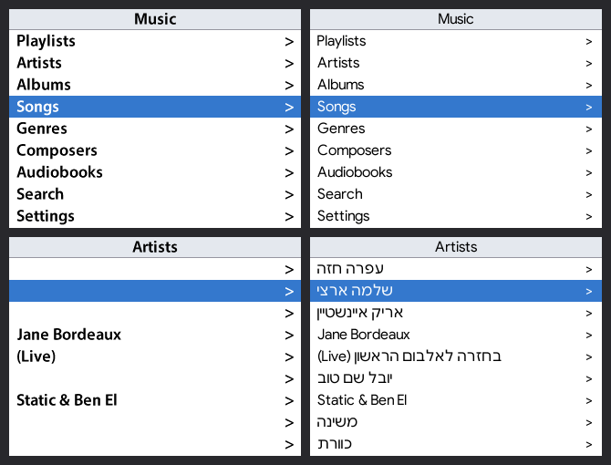

# ipodhe-revival

**Hebrew on the stock Apple firmware of the iPod Video (5th / 5.5th generation).**

Apple's firmware for the iPod Video has no Hebrew glyphs and no right-to-left support:
Hebrew song titles show up blank. In 2005-2007 Israel's Apple distributors (Yeda, later
iDigital) shipped *iPodHE*, which fixed this, but it died with its activation server and
never supported the final firmware (1.3). This project re-implements the same approach
with open tools, working from **your own firmware backup** - no Apple or iPodHE files are
included or needed.



<sub>Left: Apple's original menu font - Hebrew names are blank. Right: patched with Google Sans + Hebrew.
Rendered with `ipodhe_revival.py preview`; verified on a real 5.5G.</sub>

## How it works

Two small changes to the firmware partition, plus one helper you run after syncing:

1. **Font** - on the 5G/5.5G the menu font is an ordinary file, `Resources/Fonts/PodiumSans18.ttf`,
   inside the `rsrc` image (a small FAT volume). We rebuild it from Apple's original, redraw it
   from a font of your choice and **add the Hebrew letters** (nothing of Apple's is removed).
2. **Database name** - the firmware's three references to `iTunesDB` become `iTunesHE`
   (same length, 6 bytes total). The iPod then reads a *second* database that iTunes never touches.
3. **Flip** - after each sync, `flip` copies `iTunesDB` to `iTunesHE`, rewriting Hebrew titles,
   artists, albums etc. into visual (display) order with the full Unicode bidi algorithm, so mixed
   text like `בחזרה לאלבום הראשון (Live)` displays correctly. Your iTunes library stays clean.

Image checksums in the partition directory (plain 32-bit byte sums) are recomputed. The Rockbox
bootloader, if installed, is preserved untouched.

## Requirements

* iPod Video **5G or 5.5G** (tested: 5.5G, Apple firmware **1.3**, 250 GB flash mod, Rockbox bootloader)
* [`ipodpatcher`](https://download.rockbox.org/bootloader/ipod/ipodpatcher/) (Rockbox project) - run as Administrator/root
* Python 3.9+ and `pip install -r requirements.txt`
* A font with Hebrew: a Rockbox anti-aliased `.fnt` (e.g. `19-GoogleSans.fnt`) **or** any TTF/OTF

> **Not supported:** iPod classic (6G/7G) and nano 3G+ - their firmware is encrypted and signed.
> Use [Rockbox](https://www.rockbox.org/) there; it handles Hebrew natively.

## Step by step (Windows; on macOS/Linux use the device path ipodpatcher shows)

Close iTunes. Open an **Administrator** command prompt in this folder.

```bat
:: 1. find the iPod and back up its firmware partition  (read-only)
ipodpatcher --scan
ipodpatcher 6 -r backup.bin            :: use YOUR disk number instead of 6
python ipodhe_revival.py info backup.bin

:: 2. build the font from Apple's original + your font
python ipodhe_revival.py extract-font backup.bin -o apple.ttf
python ipodhe_revival.py build-font --apple apple.ttf --source 19-GoogleSans.fnt -o hebrew.ttf
::    (TTF/OTF source:  --source NotoSansHebrew-Regular.ttf --size 18)

:: 3. look before you flash
python ipodhe_revival.py preview apple.ttf hebrew.ttf -o preview.png

:: 4. create the patched partition and flash it
python ipodhe_revival.py patch backup.bin --font hebrew.ttf -o patched.bin
ipodpatcher 6 -w patched.bin
```

Copy `backup.bin` somewhere safe - it is your way back.

**Booting:** with the Rockbox bootloader installed, hold **Menu** during start-up to boot Apple's firmware.

## Every sync

```bat
:: sync in iTunes, wait until it finishes, then (iPod still connected, "Enable disk use" on):
python ipodhe_revival.py flip E:\        :: the iPod's drive letter
```

Run it after **every** sync, English-only ones included - the iPod only reads `iTunesHE`, so new
songs, playlists and ratings appear once you've run `flip`.

## Restore / uninstall

```bat
ipodpatcher 6 -w backup.bin
```

Restores the firmware partition exactly as it was (Rockbox bootloader included). If the iPod won't
boot, enter disk mode (Menu+Select to reboot, then Select+Play) and run the same command.
Don't use iTunes "Restore" unless you want to start from scratch - it wipes the patch and the Rockbox bootloader.

## Notes & limitations

* Apple's firmware only shows music synced by iTunes (folders copied by hand are Rockbox-only).
* Some accented capitals (e.g. `Ů`) may be clipped 1-2 px at the top with tall fonts; Hebrew and English fit.
* Menus stay in English - the iPodHE menu translations are not included.
* `aupd` showing a checksum mismatch in `info` is normal (Apple stores a different value there).
* Earphone in-line remotes (volume/play) don't work on any 5G/5.5G - the headphone jack has no
  detection hardware. That's not related to this patch.

## Credits

* **Yinon Yamin** - original iPodHE (2005) and the iTunesDB "Flipper"
* **Aviram Rahana, Omri Patai** (israPod) and **Ido Mendelson** (HebPod) - early Hebrew iPod patches
* **Yeda / iDigital** - distributed iPodHE 2006-2009
* The person who preserved the iPodHE installers on archive.org, which made the analysis possible
* **Rockbox project** - `ipodpatcher` and the `.fnt` format
* [python-bidi](https://github.com/MeirKriheli/python-bidi), [fontTools](https://github.com/fonttools/fonttools), [freetype-py](https://github.com/rougier/freetype-py)

## Legal

This repository contains only original code. It does not include Apple firmware, Apple fonts,
iPodHE binaries or third-party fonts - the tools operate on files you dump from your own device and
fonts you have the right to use. Modifying firmware is at your own risk; keep your backup.
iPod and iTunes are trademarks of Apple Inc.; this project is not affiliated with Apple, Yeda or iDigital.
